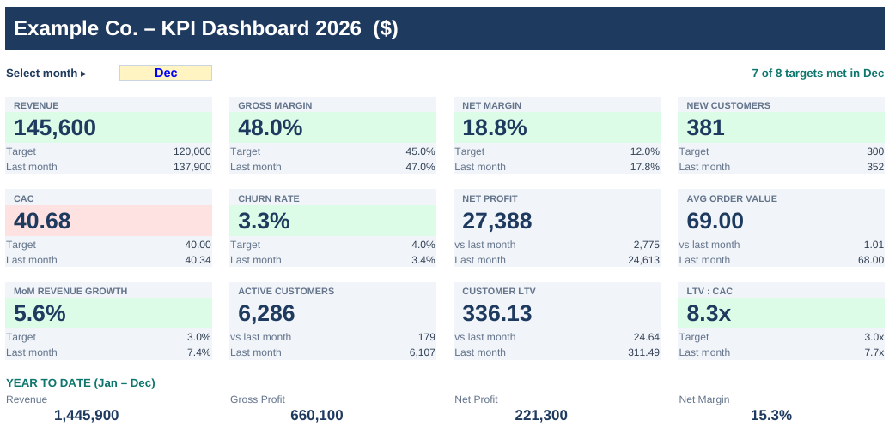
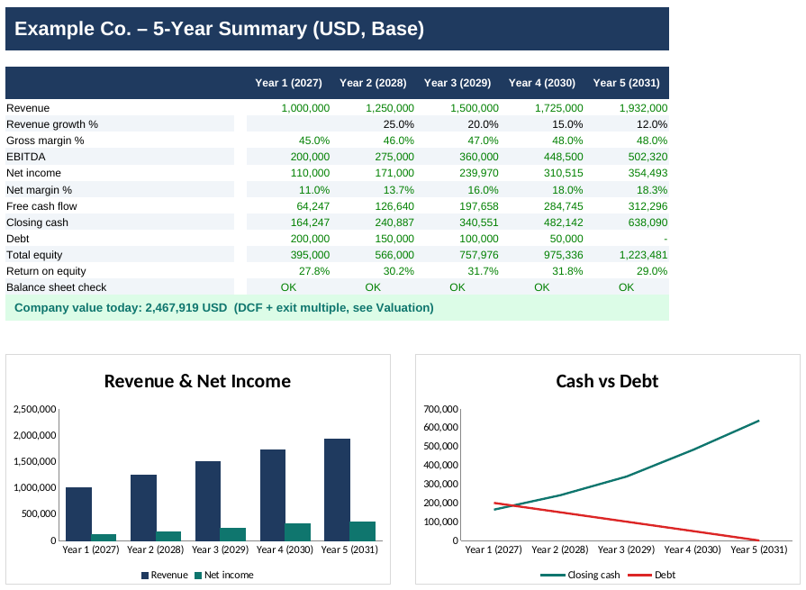
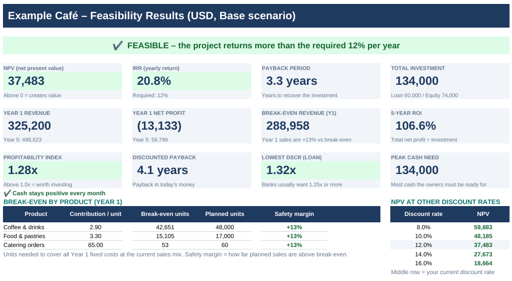

# Meshari A. — MQL5 Developer & Trader

**Expert Advisors · Risk Management Systems · Excel Financial Models**

I turn trading strategies into reliable MT4/MT5 Expert Advisors, built and tested by a trader with 17+ years of market experience. Tools designed by someone who actually trades, not just codes.

---

## Background

- 17+ years trading forex and gold (XAUUSD and major FX pairs), active since 2008
- Co-founded a fintech company that built trading software and data solutions for banks, brokerage firms and hedge funds (2015–2020)
- Risk management experience with financial companies, hedge funds and managed accounts
- Published MT5 product on the MQL5 Market: **Risk Manager Pro** (MT5 utility)
- BBA, Economics — King Abdulaziz University
- Languages: Arabic (native), English (fluent)

## What I build

| Area | Examples |
|---|---|
| Expert Advisors (MT4/MT5) | Your strategy rules turned into a tested EA |
| Risk management | Lot sizing, daily and overall drawdown limits, equity protection |
| Trade managers | Break-even, trailing stop, partial close, basket management |
| Connectivity | Broker and liquidity connectivity via FIX API (FIX 4.4) |
| Indicators & dashboards | Custom indicators, alerts and trading dashboards |
| EA maintenance | Fixing, optimizing and backtesting existing EAs |
| Excel financial models | 3-statement models, KPI dashboards, feasibility studies |
| Arabic localization | Native Arabic translation for fintech and trading projects targeting the Gulf market |

## Work samples

### MT5 tools (own products)

- **RM Pro Advanced Trade Manager** — places market and pending orders with the lot size calculated from the dollar risk and stop loss you set, from an on-chart panel.
- **DrawdownGuard** — account protection for prop-firm challenges and personal risk control: enforces daily-loss and max-drawdown limits, and when a limit is hit it closes positions, deletes pending orders and keeps the account locked. It never opens trades.

*Source code is private. Screenshots and demos are available on request.*

### Excel financial models

All example figures are fictional and only show how each model works.

**KPI Dashboard — monthly business performance**
Pick a month and every KPI updates against its target: revenue, margins, CAC, churn, LTV, LTV:CAC.

**3-Statement Financial Model — 5-year projection**
Income statement, balance sheet and cash flow fully linked and always balanced, with scenarios, 15 ratios and DCF valuation.

**Feasibility Study — investment decision in one page**
NPV, IRR, payback, break-even by product, DSCR and a clear feasible / not feasible verdict.

## How I work

1. I review your strategy or model first and point out risks before building.
2. Every EA is tested in the Strategy Tester before delivery.
3. Clean source code, clear settings, and free bug fixes for 14 days after delivery.
